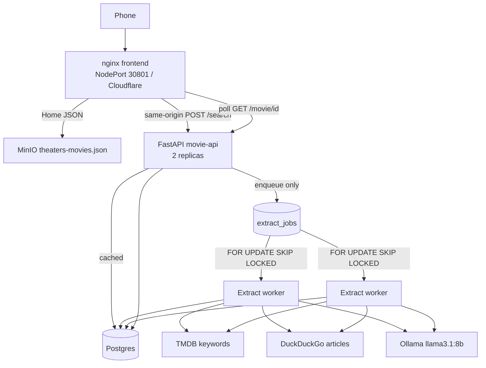

# Movie Post-Credits & Easter Eggs

A small app that answers two questions for a movie in theaters (or one you search): **are there post-credits scenes, and what easter eggs did the articles mention?**

Nightly, the cluster pulls TMDB’s now-playing list, records credit-scene keywords, and exports Home JSON. Uncached searches go on a Postgres to-do list; two workers fetch live articles and ask Ollama to extract only what those pages say. No Reddit, no IMDb HTML, no OpenAI, no Kafka, no Redis.

- [Architecture](#architecture) — how a phone request becomes eggs in Postgres
- [Screenshots](#screenshots)
- [Kubernetes notes](./KUBERNETES.md) · [Quick start](./QUICK_START.md)

## Screenshots

[In theatre](./images/home.png)
[Recent Search](./images/recent.png)

## Architecture

This is the live k3s system as this repo implements it — not a wishlist.

### Cluster

Two k3s nodes: a control-plane and a worker. Everything below lives in namespace `movie-api`.

### Serving

Phones hit the **nginx frontend** (NodePort **30801**, Cloudflare tunnel). That origin is the only one a client needs. Nginx same-origin proxies FastAPI (`movie-api`, **2 replicas**), MinIO JSON, and TMDB poster images, so a phone does not open extra NodePorts.

**Postgres is the source of truth** for movies, post-credits flags, and easter eggs. **MinIO** holds the nightly export `theaters-movies.json` that the Home tab reads. **TMDB** is used for search, posters, and keyword tags **179430** (post-credits) and **179431** (mid-credits) — those tags are what set `has_scene` / `scene_count`.

### Uncached search

`POST /search` does **not** run Ollama in the API process. It enqueues a row (or no-ops if one is already queued/running) and returns a processing payload immediately. The frontend shows **Analyzing** and polls `GET /movie/{id}` until Postgres has a result (or the poll budget runs out). Refresh is the same enqueue path.

### Queue

The to-do list is the Postgres table `extract_jobs` (`INSERT ON CONFLICT` on `movie_id`). Two extract-worker replicas are a **competing-consumer group** on that table — not a log, not Kafka.

Each worker claims with `SELECT … FOR UPDATE SKIP LOCKED LIMIT 1`, marks the row `running`, **commits**, then runs the extract. The row lock is **not** held during Ollama. If a worker dies, the row stays `running` until the stale timeout: `running` and `started_at` older than **10 minutes** and `attempts < 3` → back to `queued`; otherwise `failed`. Ten minutes is longer than the 420s Ollama timeout so a live job is not stolen.

An empty extract **must not DELETE** existing `easter_eggs`. If the articles or the model come back empty, the old rows stay.

### Extract

Workers search **DuckDuckGo HTML**, fetch a few live articles, and send that text to **Ollama `llama3.1:8b`**. The model may extract only what is in the articles — it must not invent. Both worker pods share one Ollama host, so CPU will contend. There is no Reddit scrape, no IMDb HTML, and no OpenAI key.

### Cache layers

Three things look like caches; only one is authoritative.

1. **Postgres rows** are the real cache. If the movie is already analyzed, `/search` returns it.
2. **Home JSON** is a nightly MinIO export (`theaters-movies.json`). The Home tab lists current theater titles from that file even before eggs exist.
3. **The browser does not cache movie insights** — no localStorage of eggs or `hasScene`. Recent Searches is a UI list of titles you already resolved, not a second database.

A CDN/JSON hit is instant for the card. Eggs and `hasScene` only show when they already exist in that export or in Postgres.

### Why not Kafka

A Kafka topic is a log. We need a **to-do list**: one job per movie, claim it, retry it, time it out. Postgres already stores the movies; `extract_jobs` plus `FOR UPDATE SKIP LOCKED` is the queue.

